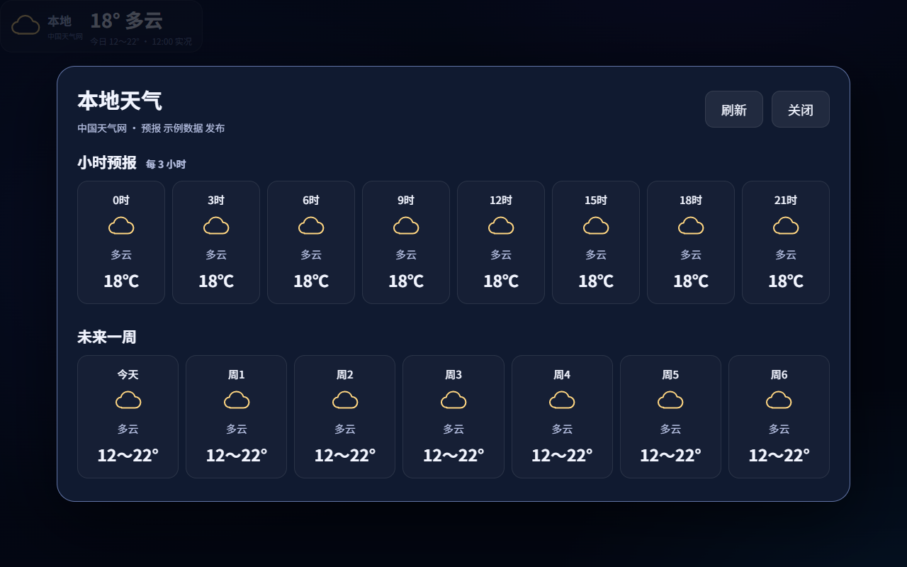

# ThinkSmart View 首页扩展

为半格的 ThinkSmart View Ubuntu 镜像增加国内天气、QQ 音乐和本地语音指令。感谢半格、rickx 和 QQMusicApi 社区提供基础项目，本项目在这些工作的基础上增加独立扩展模块。

已验证环境为 Lenovo ThinkSmart View CD-18781Y、Ubuntu 24.04 ARM64、半格客户端 0.1.3。需要先安装半格系统及其客户端、网关；本仓库提供扩展源码和安装脚本，不包含刷机镜像。

## 当前功能

- 天气卡片放在时间附近，显示图标、当前天气和温度、今日高低温。点击展开每 3 小时预报和七天预报。
- 自动定位优先使用 IP138 的区县信息，匹配不到区县时使用所在城市，IP138 不可用时使用腾讯城市定位。天气数据来自中国天气网，无需手填位置或配置天气 Key。
- 本地天气播报直接读取天气模块数据，不调用大模型；只播报天气和温度，不念观测时间或来源。
- QQ／微信扫码登录，使用自己的音乐账号访问个人歌单、歌曲、封面和同步歌词。
- 默认随机播放热歌榜，支持榜单顺序播放、猜你喜欢、个人歌单和按歌名／歌手点歌。
- 首页右侧上方 75% 显示播放器，下方 25% 保留对话。默认封面，点击切换歌词；图标控制、细线进度条。停止音乐恢复完整对话区。
- 音乐语音指令执行并回复后停止连续监听，下次操作需重新唤醒“小麦小麦”。播放器和唤醒词检测继续运行，普通聊天保留原来的连续对话规则。

“本地指令”指识别文字后的规则分流和固定回复，不代表全程离线。语音识别、语音合成沿用原网关配置，音乐和天气仍需联网。

## 界面预览

预览使用测试曲目、占位封面和示例天气，不包含实际位置信息。




## 安装与首次使用

在设备上以 `ubuntu` 用户运行。安装脚本按半格的默认路径适配，要求客户端、网关和 `~/.local/bin/uv` 已就绪；安装音乐时需要访问 GitHub 和 Python 包索引。仓库访问权限需自行具备。

```bash
git clone https://github.com/gsyylove/thinksmart-view-extensions.git
cd thinksmart-view-extensions
bash install.sh all
```

也可单独执行 `bash install.sh weather` 或 `bash install.sh music`。模块安装到 `/opt/thinksmart/extensions`；脚本会备份挂接文件，再重启相关服务，当前播放和对话会中断。网关重启后需要等待语音组件加载。

首页点击“音乐”，选择 QQ 或微信扫码并在手机确认登录。之后可以语音播放或点“我的歌单”手动选曲。播放权限由自己的账号权益、数字专辑及版权限制决定，会员不保证所有歌曲都可播放。当前未接入网易云音乐。

天气自动更新，无需注册定位服务。IP 定位可能对应运营商或代理出口所在城市，不保证区县精度。定位失败时不猜测默认城市。详情见[天气模块](extensions/weather/README.md)。

## 语音操作

先唤醒“小麦小麦”，再说指令。

| 指令 | 实际行为 |
| --- | --- |
| 播放音乐／随机播放音乐／随便放点歌 | 取热歌榜前 100 首并打乱，按打乱后的顺序播放 |
| 播放热门音乐／播放热歌榜 | 按热歌榜顺序播放 |
| 播放推荐音乐／播放猜你喜欢 | 取账号推荐，本次接口实测返回 5 首 |
| 播放我的歌单 | 从账号第一个非空歌单开始，也可在页面手动选其他歌单 |
| 播放周杰伦的晴天／我想听稻香 | 按歌手或歌名搜索；版本不明确时弹出候选供点选 |
| 暂停音乐／继续播放 | 暂停或继续当前歌曲和队列；没有当前歌曲时，继续播放会开始随机热歌 |
| 下一首／上一首／停止音乐 | 切换当前队列歌曲，或停止并恢复完整对话区 |
| 现在的天气怎么样／现在多少度 | 直接读取当前位置的当前／今日天气，跳过大模型 |

每次音乐语音操作回复完都会结束本轮语音会话，包括失败提示；下一条需重新唤醒。随机范围为热歌榜，不是整个 QQ 曲库。歌曲结束自动下一首，队列尾部循环。重新说“播放音乐”会重新获取并打乱热歌榜。不可播放时可重新唤醒后说“下一首”。

搜索队列最多保存本次 20 条结果；个人歌单按页取歌。当前不使用大模型纠正识别错字。详见[音乐模块](extensions/music/README.md)。

## 更新、移除与备份

更新本项目后，从本仓库目录重新安装相应模块：

```bash
git pull --ff-only
bash install.sh all
```

更新半格官方客户端或网关前，先移除挂接；官方更新完成后再装回模块：

```bash
bash uninstall.sh all
# 此时执行半格官方更新
bash install.sh all
```

可将 `all` 换为 `weather` 或 `music`。移除操作保留模块文件、账号数据和备份；不会自动清理账号登录。备份在设备 `/home/ubuntu/thinksmart-backups`，并非整机备份。官方页面或语音入口结构变化时，挂接脚本会停止，需要检查兼容性。

## 外部依赖与数据

| 用途 | 项目或服务 | 需要准备什么 |
| --- | --- | --- |
| 系统与语音基础 | 半格镜像、客户端和网关 | 先安装并配置好语音服务，沿用其唤醒、识别及合成能力 |
| 音乐访问 | L-1124/QQMusicApi、QQ 音乐 | 安装脚本安装固定 SDK 提交，使用自己的 QQ／微信账号扫码 |
| 天气和城市编号 | 中国天气网 | 当前页面解析方式不需要 Key，依赖网络和页面结构 |
| 定位 | IP138 公开页面，腾讯城市接口后备 | 当前实现不使用付费 API 或 Token，会向服务方暴露网络出口 IP |
| HTTP 服务 | aiohttp | 音乐依赖随安装脚本装入隔离环境；天气沿用客户端／网关现有环境 |

项目链接、固定版本、数据接口地址、许可及引用关系统一见[第三方组件与数据说明](THIRD_PARTY.md)。

音乐服务只监听 `127.0.0.1:8091`，天气由客户端本地接口提供。QQ 授权凭据保存在设备 `~/thinksmart-music/state/credential.json`，目录权限 700、文件权限 600。服务不提供凭据读取接口。公网 IP 不写入天气配置、接口响应或日志，但自动定位结果会显示在设备界面。

账号数据、API Key、SSH 私钥、刷机镜像、安卓备份和聊天数据库请留在自己的设备上，勿提交到仓库。仓库公开示例不包含个人位置。

## 验证范围

在上述设备环境验证过扫码登录、个人歌单、会员标记歌曲的播放链接与音频时长、热歌榜 100 首、猜你喜欢 5 首、随机播放、切歌、暂停继续及停止。验证过从监听到音乐回复后待机，再次唤醒可控制；麦克风音频上传在待机后停止。

浏览器检查过 3:1 分区、封面歌词切换、细线进度拖动、点歌候选、随机队列、顺序热歌及播完自动下一首。天气验证过 IP138 区县匹配、实况、小时和七天预报。`tests/` 包含定位匹配与降级、音乐指令识别和单次交互的针对性测试。

尚未在全新设备上完整演练安装流程，也未覆盖所有官方版本和长期运行场景。现场唤醒和语音识别准确率仍取决于环境及原有 ASR 配置。

## 致谢与许可

感谢以下作者、维护者与贡献者公开分享代码、适配经验和文档，让这台设备能够继续发挥作用：

- [rickx/ubuntu-thinksmart](https://github.com/rickx/ubuntu-thinksmart)：ThinkSmart View 的 Ubuntu 适配、驱动和刷机基础工作，也是半格镜像的上游基础。
- [半格系统镜像](https://github.com/justhalfbit/thinksmart-ubuntu-image)、[语音客户端](https://github.com/justhalfbit/xiaozhi-thinksmart-client)、[小智网关](https://github.com/justhalfbit/xiaozhi-hub-server)：本扩展实际使用的系统、首页及语音交互基础。
- [L-1124/QQMusicApi](https://github.com/L-1124/QQMusicApi)：实际接入的 Python QQ 音乐 SDK，支持扫码、歌单、榜单、推荐、播放地址与歌词等能力。
- [jsososo/QQMusicApi](https://github.com/jsososo/QQMusicApi)：早期音乐接口调研参考，未部署其 Node 服务。
- [aiohttp](https://github.com/aio-libs/aiohttp)：异步 HTTP 客户端与服务端基础。

也感谢[中国天气网](https://www.weather.com.cn/)、[IP138](https://www.ip138.com/)、[腾讯新闻](https://news.qq.com/)和 [QQ 音乐](https://y.qq.com/)提供相关数据与服务。项目引用不表示这些作者或平台对本扩展提供背书或兼容性承诺。

本项目采用 GPL-3.0，见 [LICENSE](LICENSE)。第三方组件与平台内容各自保留原有权利，具体见 [THIRD_PARTY.md](THIRD_PARTY.md)。
